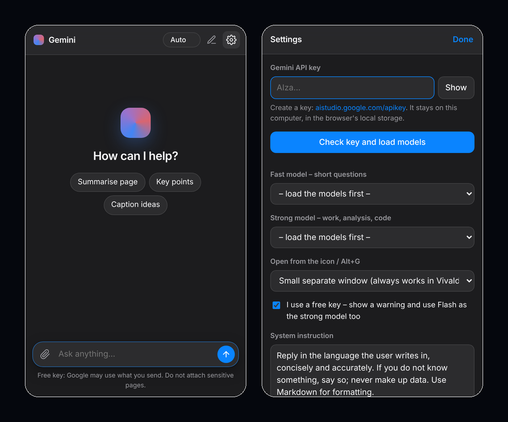

# vivaldi-workspace

A clean, personal browser setup built on Vivaldi: Brave-style privacy settings, a macOS-style interface and a custom Gemini side panel.

## Contents

| Folder | What it is |
|---|---|
| `extension/` | **Gemini Panel** – a Manifest V3 extension (Vivaldi, Edge, Brave, Chrome) |
| `setup/` | `apply_vivaldi_settings.py` – writes privacy, theme and panel settings into the Vivaldi profile |
| `vivaldi-mods/` | `macos.css` – CSS that restyles the Vivaldi interface |

## Gemini Panel

<picture>
  <source media="(prefers-color-scheme: dark)" srcset="docs/images/gemini-panel-dark.png">
  <source media="(prefers-color-scheme: light)" srcset="docs/images/gemini-panel-light.png">
  
</picture>

- Chat with the Gemini API, with streamed replies and Markdown rendering.
- **Automatic model choice:** short questions go to the fast model (Flash-Lite); work, analysis, code or long messages go to the strong model (Flash, or Pro with a paid key). You can switch manually in the header (Auto / Fast / Strong). If the strong model is unavailable (limits, access), the fast model answers.
- **Attach the page** (paperclip), or right-click: *Ask Gemini about the selection* / *Summarise page*.
- Open it with the icon or **Alt+G** – as a small separate window (Vivaldi) or a side panel (Chrome-style browsers). It can also be loaded as a Vivaldi web panel (the URL is shown in Settings).
- The model list is fetched with your key, so you never type model names by hand.

### Install

1. `vivaldi://extensions` → turn on **Developer mode** → **Load unpacked** → select the `extension` folder.
2. In the panel: Settings → API key (<https://aistudio.google.com/apikey>) → **Check key and load models**.

### Data handling

- The API key and the chat stay in the browser's local storage (`chrome.storage.local`); nothing is synced.
- Page content is read only when you press the button or use the right-click menu; reading all sites needs a one-time permission.
- Network traffic goes only to `generativelanguage.googleapis.com`.
- **With a free key, Google may use the content you send** to improve its products; on the paid tier it does not. Do not send sensitive pages with a free key.

### Files

| File | Role |
|---|---|
| `manifest.json` | permissions, Alt+G, side panel |
| `background.js` | icon, context menu, opening the window / side panel |
| `panel.html` / `panel.css` / `panel.js` | chat UI and logic |
| `gemini.js` | Gemini API: model list, suggested model pair, streamed replies |
| `md.js` | small, safe Markdown renderer (escapes first) |
| `extract.js` | extracts the page text |
| `store.js` | storage (`chrome.storage.local`, `localStorage` in preview) |

Preview without installing the extension (layout only, no API calls):

```powershell
python -m http.server 5174 --directory extension
```

## Vivaldi settings from a file

`setup/apply_vivaldi_settings.py` writes the profile based on Vivaldi's own `prefs_definitions.json` (it runs only while Vivaldi is closed and makes a backup first):
blocks third-party cookies, HTTPS-only, WebRTC IP protection, search suggestions and preloading off, Quad9 DNS-over-HTTPS, blocking at the strongest level,
two macOS themes (following Windows light/dark mode), the CSS mod folder and web panels. It does not touch Chromium's protected keys (extensions, search engine, start page).

```powershell
python setup/apply_vivaldi_settings.py
```

In Vivaldi 8.3 the Gemini Panel does not persist as a web panel; open it with Alt+G or its icon.

## Vivaldi CSS

`vivaldi://experiments` → *Allow for using CSS modifications* → Settings → Appearance → *Custom UI Modifications* → the `vivaldi-mods` folder → restart Vivaldi.
Vivaldi's internal class names can change; a rule that no longer matches simply has no effect.
